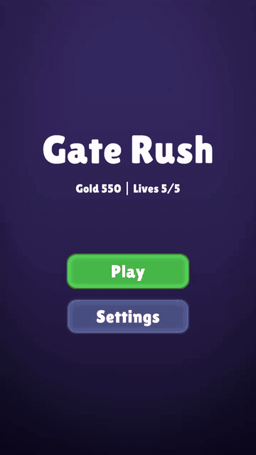
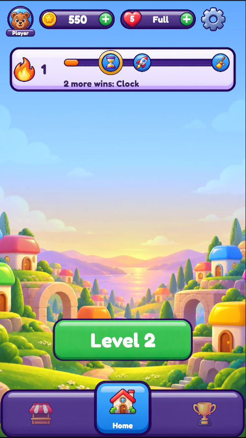
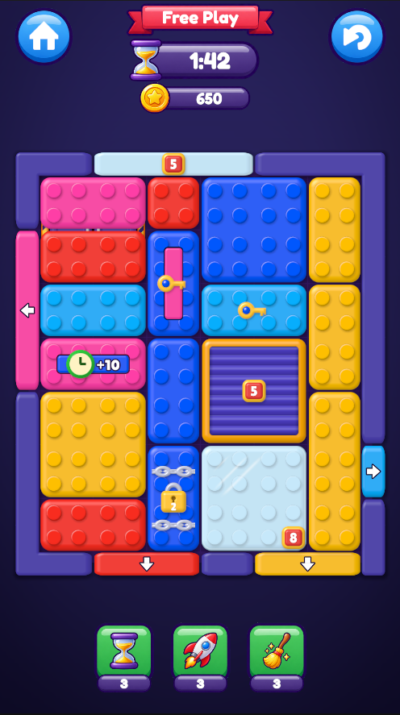
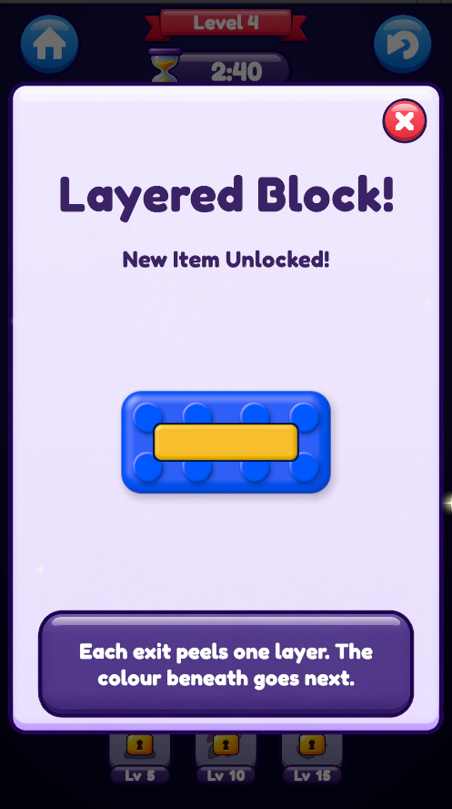
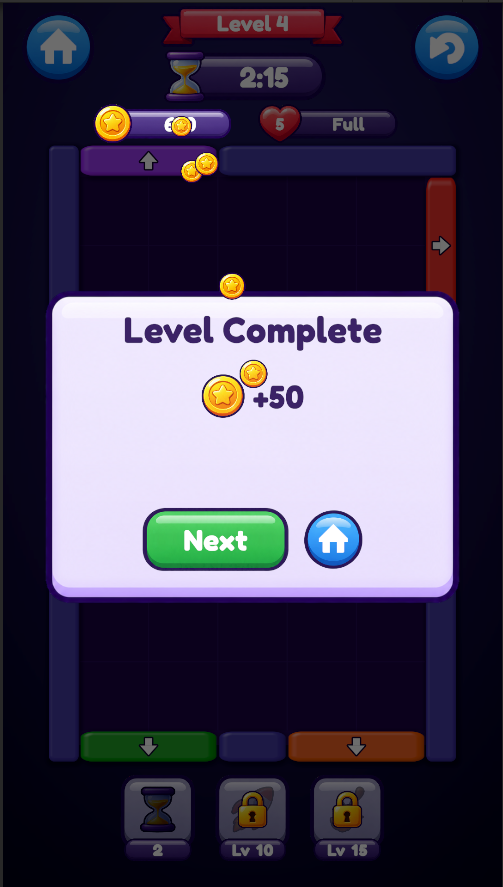
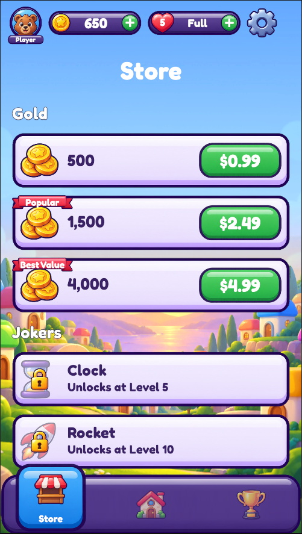
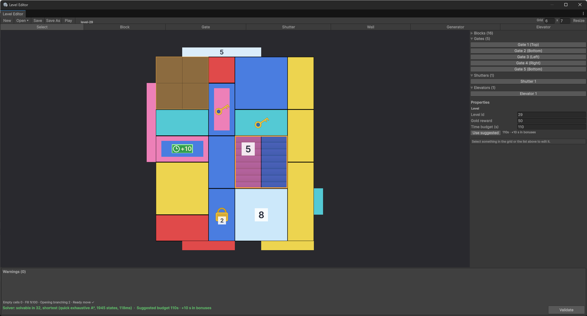
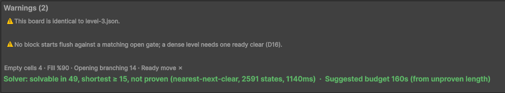

# Gate Rush

A sliding-block puzzle game built in Unity as a portfolio project, with an
emphasis on engine-independent game logic, solver-verified level design, and a
documented architecture.

<p align="center">
  
</p>

**▶ Play in browser:** [inanakmugan.itch.io/gate-rush](https://inanakmugan.itch.io/gate-rush)

Unity 6000.3.25f1 (6.3 LTS) · Universal Render Pipeline, 2D Renderer · WebGL

**Status:** finished. Thirty levels introduce ten mechanics and three jokers
in turn, and every one is proved solvable by the project's solver. Around the
puzzle sits a full meta game: gold, lives that come back on a real-time clock,
a win streak that pays jokers, a Store that sells gold packs through a
simulated purchase service that charges nothing, a Profile with the player's
name and one of thirty avatars, and a Leaderboard that ranks the player among
labelled demo players. The interface is drawn in a glossy style with
AI-assisted art, with a town painting behind the menu that turns from day to
night as the campaign goes on; the board is still generated by code, shaded by
a lit model into soft plastic toy bricks, with light pooled effects and
balanced sound. The itch.io build is the current version, and the web is the
only target: no phone build is planned (D82). How it was built, phase by
phase, is in [`docs/ROADMAP.md`](docs/ROADMAP.md).

---

## What it is

Blocks slide freely across a tightly packed grid and are pushed out through
colour-matched gates on the board edges. Moves are unlimited; the only pressure
is a countdown. Nine more mechanics layer on top: count-gated gates and
blocks, layered colour stacks, shutters, block generators, elevators, axis
restrictions, lock-and-key pairs, and time bonuses.

## Screens

<p align="center">
  
  
  
  
  
</p>

## What is interesting about it

**The rules do not know Unity exists.** Board logic, search and the
economy are plain C# in assemblies compiled with engine references
disabled, so the layer boundary is a compile error, not a convention. The
entire rule set runs in an Edit Mode test suite in milliseconds, without
loading a scene.

**Levels are proved solvable before they ship.** A custom editor window
validates every level on demand: an exhaustive A\* search first, then — for
levels too large for it — a nearest-next-clear search that commits to one clear
at a time — complete wherever a monotonicity argument holds, and cross-checked
by A\*.
It answers three ways — solvable, unsolvable, or indeterminate within budget —
and says whether a solution's length is proven shortest. That length produces
the level's suggested time budget, so difficulty pacing is measured rather than
guessed.

**Ten mechanics compose without knowing about each other.** Every removal in the
game emits one event; every unlock condition listens to that event; the resolver
loops to a fixpoint. A single clear can release a key that unlocks a block,
cross a shutter's threshold and open it, and empty an elevator's region so its
next wave arrives — all within one move, with no mechanic referencing another.

**The search space is stratified, not cyclic.** Because blocks leave the board
permanently, progress counters increase monotonically, so the state graph is a
one-way layering of strata. Breadth-first search discards each stratum's
visited set on advance, bounding memory to the largest single stratum rather
than the whole space; nearest-next-clear searches one stratum at a time. This
is the structural difference from Rush Hour–style puzzles, where nothing is ever
removed.

**The economy is a unit test.** Lives come back on UTC timestamps read
against a clock passed in, never the system clock, so "win three, lose
one, wait forty minutes" runs in milliseconds against a clock the test
moves. One `MetaGame` object takes every campaign result and purchase and
never saves; the save is one versioned JSON blob whose loader carries
older versions forward.

## The level editor

<p align="center">
  
</p>

Every mechanic is authored in one editor window: blocks, gates, shutters,
walls, generators and elevator waves. Warnings update live as the level is
built, and **Validate** runs the solver off the main thread. The footer above
reads *solvable in 32, shortest* for level 29, with the states explored, the
time taken and the countdown the level should get.

<p align="center">
  
</p>

The warnings catch authoring mistakes before the solver runs: a colour with
no gate to leave through, a gate too narrow for a block, a lock without
enough keys, a board that is an exact copy of another level. They never
block saving; they are what a designer reads while building.

## Architecture

```
Core            board rules            no engine references
Solver          search                 no engine references, editor-only
Meta            economy, lives         no engine references
Platform        service interfaces     no engine references
Serialization   JSON DTOs
Runtime         MonoBehaviours, DOTween, input
UI              screens and navigation, uGUI prefabs (Phase 6)
```

Full write-up: [`docs/ARCHITECTURE.md`](docs/ARCHITECTURE.md)

## Documentation

| Document                                       | Contents |
|------------------------------------------------|---|
| [`docs/ARCHITECTURE.md`](docs/ARCHITECTURE.md) | Layers, dependency rules, core concepts |
| [`docs/MECHANICS.md`](docs/MECHANICS.md)       | Normative rules for all ten mechanics |
| [`docs/DECISIONS.md`](docs/DECISIONS.md)       | Decision record with rejected alternatives |
| [`docs/Modules/`](docs/Modules/)               | Per-module specifications |
| [`docs/CONVENTIONS.md`](docs/CONVENTIONS.md)   | Coding standards |
| [`docs/ROADMAP.md`](docs/ROADMAP.md)           | Build order |

## On process

The implementation was written with Claude Code. The architecture, the mechanic
rules, and the module specifications in `docs/` are mine; they were written first
and the code was written against them. `DECISIONS.md` records what was chosen,
why, and what was rejected — including dropping procedural level generation in
favour of a hand-authoring editor with live solver validation.

## Running the tests

Unity → Window → General → Test Runner → Edit Mode → Run All

3,385 Edit Mode tests. None of the suites needs a scene: `Core`, `Solver`,
`Meta`, `Serialization`, the editor's logic and the plain parts of `Runtime`
are all tested headless.

## Credits

- Interface art, avatars and the town paintings: drawn for this project
  with AI assistance, generated from a written style guide and then cut,
  cleaned and sized by hand.
- Button glyphs: [Kenney](https://kenney.nl) — Game Icons, and one
  checkmark from the UI Pack, CC0.
- Fonts: [Fredoka](https://fonts.google.com/specimen/Fredoka), with
  [Nunito](https://fonts.google.com/specimen/Nunito) ExtraBold as the
  fallback for Turkish letters, and
  [Lilita One](https://fonts.google.com/specimen/Lilita+One) for the
  board's labels, all SIL Open Font License 1.1.
- Sound effects: [Kenney](https://kenney.nl)'s audio packs, CC0, except
  the soft lift and drop sounds, which were made for the game.

The licences of Kenney's glyphs and of the three fonts are kept beside
the files under `Assets/ThirdParty/`.

## Note on the web build

Progress (completed levels, gold, lives and the campaign) is stored in
browser storage. Clearing site data resets it, and so does a new upload of
the build on itch.io, since each upload is served from a new path.
